# AŞAMA 12: UML ve Process Modeling Package
## Open Banking API Entegrasyonu ve Hesap Bilgisi Paylaşım Platformu

> Bu paket, Aşama 5 (BRD), Aşama 6 (User Stories), Aşama 7 (SRS) ve Aşama 4.5 (Solution Architecture Overview) ile tam tutarlı olacak şekilde hazırlanmıştır. Yeni gereksinim veya test case içermez.

---

## 1. Use Case Diagram

### Amaç
Sistemin sunduğu temel işlevleri ve bu işlevlerle etkileşen aktörleri üst seviyede göstermek. BRD (Bölüm 9) ve User Story (Aşama 6) kapsamındaki tüm Epic'lerin (Consent Management, TPP Onboarding, AIS, Security, Audit) use case karşılıklarını sunar.

### Aktörler / Bileşenler
- **Customer** (Müşteri)
- **TPP** (Third Party Provider)
- **Compliance Officer**
- **InfoSec Officer**
- **System: API Gateway** (otomatik aktör)

### Mermaid Formatı

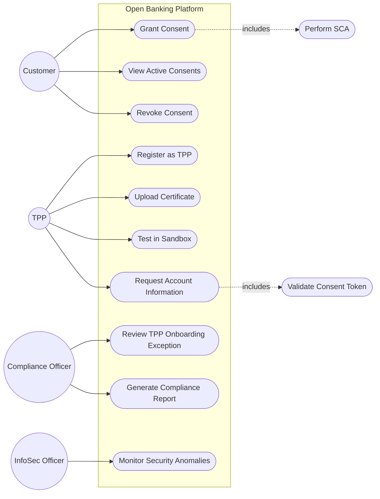

### Draw.io Uyumlu Açıklama
- **Şekil Önerisi:** Standart UML Use Case notasyonu (oval = use case, çubuk adam = aktör, dikdörtgen = sistem sınırı "Open Banking Platform")
- **Konumlandırma:** Customer ve TPP soldan, Compliance/InfoSec sağdan sistem kutusuna bağlanır
- **İlişki Türleri:** `<<include>>` ilişkisi, "Grant Consent" → "Perform SCA" ve "Request Account Information" → "Validate Consent Token" arasında kullanılmalı (drawio'da kesikli ok + include etiketi)
- **Draw.io Şablonu:** "UML > Use Case" kategorisindeki hazır şekil kütüphanesi kullanılabilir

### PlantUML Formatı

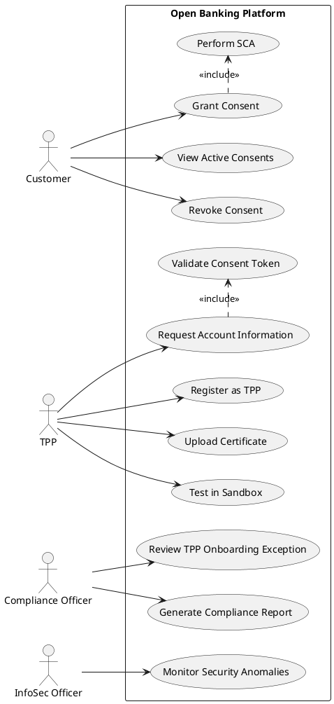

---

## 2. Activity Diagram — Consent Management Flow

### Amaç
Müşterinin rıza verme sürecindeki adımları ve karar noktalarını göstermek (FR-01, FR-04, FR-18, SEC-02 ile uyumlu).

### Aktörler / Bileşenler
Customer, Mobile/Internet Banking, OAuth2 Authorization Server, Consent Management System

### Mermaid Formatı

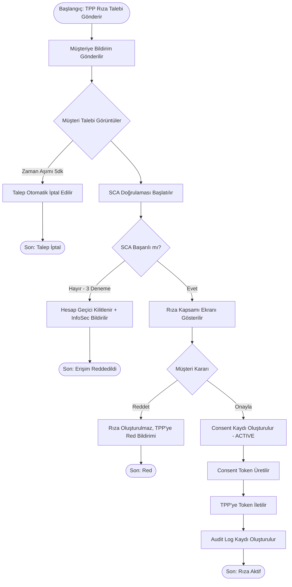

### Draw.io Uyumlu Açıklama
- **Şekil Önerisi:** Standart UML Activity notasyonu — yuvarlak köşeli dikdörtgen = aktivite, elmas = karar noktası, dolu daire = başlangıç, çevrili dolu daire = bitiş
- **Swimlane Önerisi:** Customer / Mobile-Internet Banking / Consent Management System olmak üzere 3 dikey swimlane kullanılabilir; SCA adımı "Mobile/Internet Banking" lane'inde, Token üretimi "Consent Management System" lane'inde gösterilmeli
- **Renk Kodlama:** Karar noktaları sarı, hata/red çıkışları kırmızı, başarı çıkışı yeşil

### PlantUML Formatı

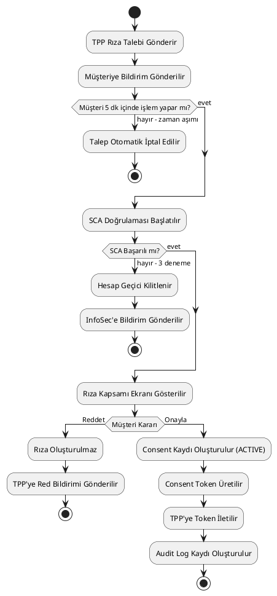

---

## 3. Activity Diagram — TPP Onboarding Flow

### Amaç
TPP'nin kayıt olmasından production erişimine kadar olan sürecin adım ve karar noktalarını göstermek (FR-07—FR-12 ile uyumlu).

### Aktörler / Bileşenler
TPP, Developer Portal, Compliance Engine, Compliance Officer (manuel istisna durumu), Sandbox Environment

### Mermaid Formatı

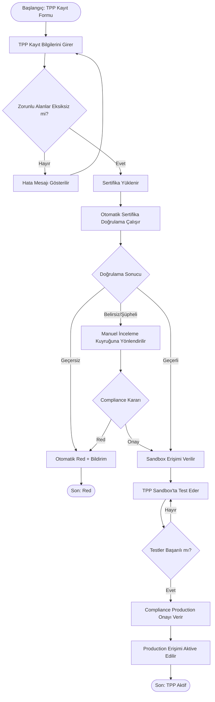

### Draw.io Uyumlu Açıklama
- **Şekil Önerisi:** UML Activity notasyonu, "Manuel İnceleme Kuyruğu" adımı için fork/join veya basit dikdörtgen kullanılabilir
- **Swimlane Önerisi:** TPP / Developer Portal / Compliance Engine / Compliance Officer olmak üzere 4 swimlane
- **Vurgu Notu:** "Otomatik Sertifika Doğrulama" ile "Manuel İnceleme" arasındaki dallanma, otomasyon + istisna yönetimi prensibini (FR-11) görsel olarak vurgulamalı

### PlantUML Formatı

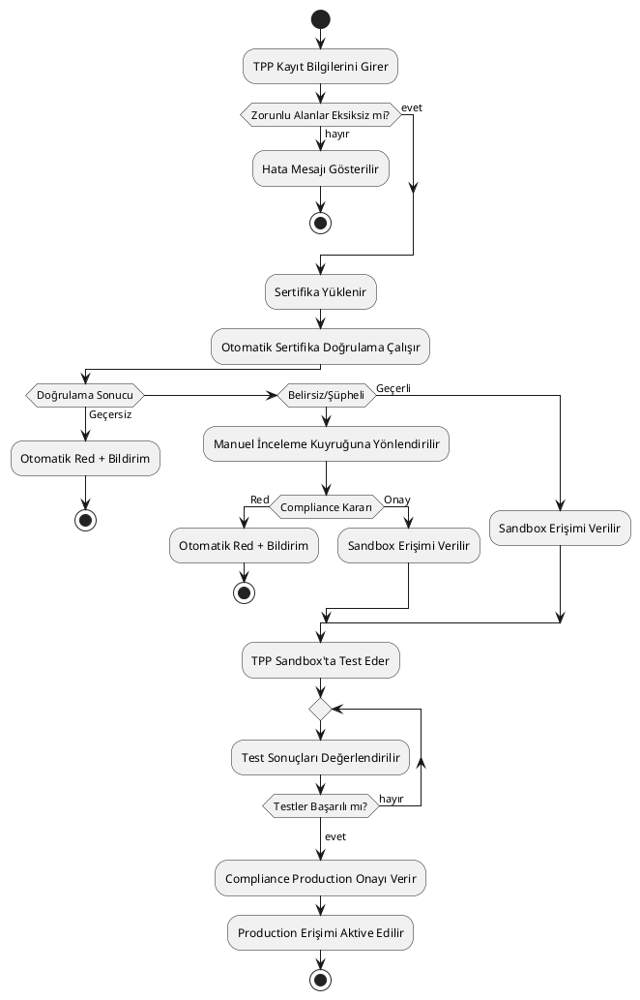

---

## 4. Sequence Diagram — Account Information Request

### Amaç
TPP'nin geçerli bir rıza kapsamında hesap bilgisine gerçek zamanlı erişim sürecindeki bileşen etkileşimlerini göstermek (FR-13, FR-14, FR-15 ile uyumlu).

### Aktörler / Bileşenler
TPP, API Gateway, Consent Management System, Core Banking, Audit & Logging Platform

### Mermaid Formatı

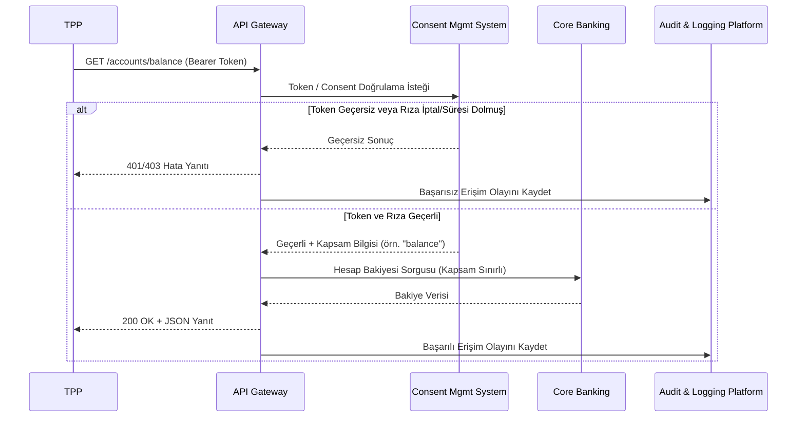

### Draw.io Uyumlu Açıklama
- **Şekil Önerisi:** UML Sequence Diagram notasyonu — dikey yaşam çizgileri (lifeline), yatay mesaj okları
- **Alt/Else Bloğu:** Draw.io'da "Combined Fragment" (alt) kutusu kullanılarak "Token Geçersiz" / "Token Geçerli" senaryoları tek diyagramda gösterilmeli
- **Renk Kodlama:** Hata yolu (alt bloğun ilk dalı) kırmızı çerçeve, başarı yolu yeşil çerçeve ile vurgulanabilir

### PlantUML Formatı

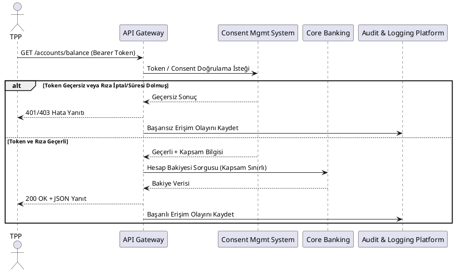

---

## 5. Sequence Diagram — Consent Creation Flow

### Amaç
Müşteri rızasının oluşturulma sürecindeki bileşen etkileşimlerini, SCA ve token üretimi dahil göstermek (FR-01, FR-18, SEC-01, SEC-02 ile uyumlu).

### Aktörler / Bileşenler
TPP, Customer, Mobile/Internet Banking, OAuth2 Authorization Server, Consent Management System, Audit & Logging Platform

### Mermaid Formatı

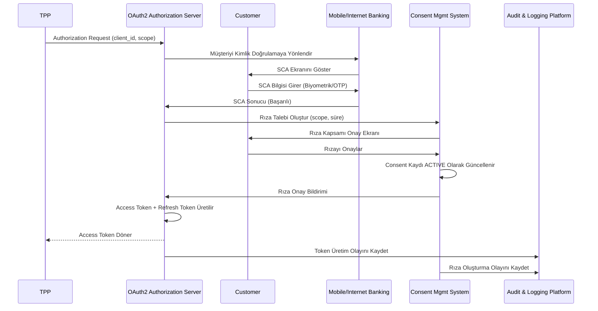

### Draw.io Uyumlu Açıklama
- **Şekil Önerisi:** UML Sequence Diagram, 6 yaşam çizgisi (TPP, OAuth2 Server, Customer, Mobile/Internet Banking, Consent Mgmt System, Audit Platform)
- **Aktivasyon Kutuları (Activation Bars):** "Consent Kaydı ACTIVE Olarak Güncellenir" gibi iç işlem adımları, Consent Mgmt System'in kendi üzerine dönen (self-message) ok ile gösterilmeli
- **Not Kutusu Önerisi:** SCA adımının yanına "Regülasyon Zorunluluğu (SEC-02)" notu eklenmesi, dokümanın iş gerekçesini güçlendirir

### PlantUML Formatı

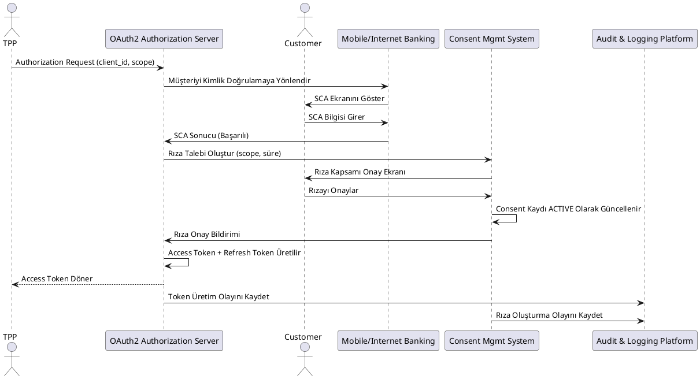

---

## 6. Domain Model / Class Diagram

### Amaç
SRS Bölüm 7'de (Data Requirements) tanımlanan veri varlıklarının (Customer, Consent, TPP, Account, Transaction, Access Token, Audit Log) ilişkilerini kavramsal düzeyde göstermek.

### Aktörler / Bileşenler
Veri varlıkları: Customer, Consent, TPP, Account, Transaction, AccessToken, AuditLog

### Mermaid Formatı

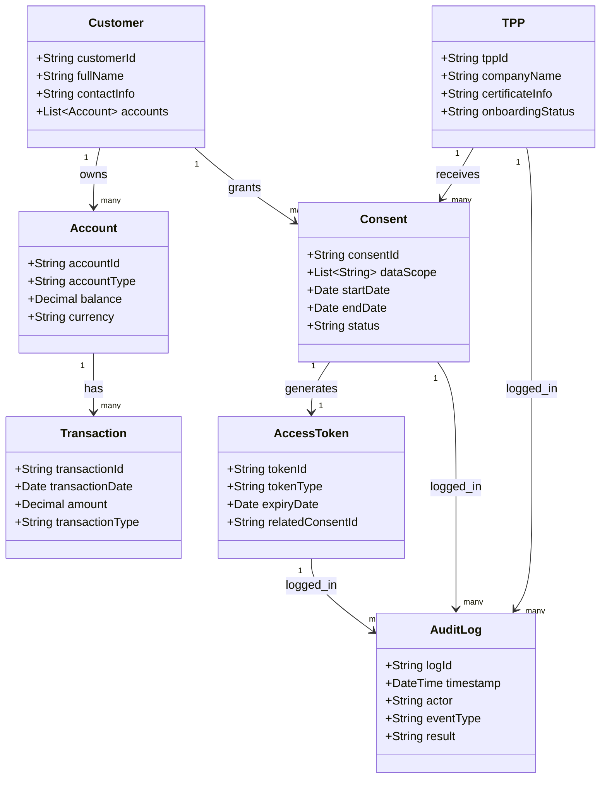

### Draw.io Uyumlu Açıklama
- **Şekil Önerisi:** UML Class Diagram notasyonu — 3 bölmeli kutular (sınıf adı / öznitelikler / metotlar — bu domain modelinde metot bölümü boş bırakılabilir, kavramsal model olduğu için)
- **İlişki Çizgileri:** "owns", "has", "grants", "receives", "generates", "logged_in" etiketli düz çizgiler; çokluk (multiplicity) değerleri (1, many) çizgi uçlarına yazılmalı
- **Renk Kodlama:** Düzenleyici/denetim açısından kritik varlıklar (Consent, AuditLog) farklı bir renkle (örn. açık kırmızı çerçeve) vurgulanabilir

### PlantUML Formatı

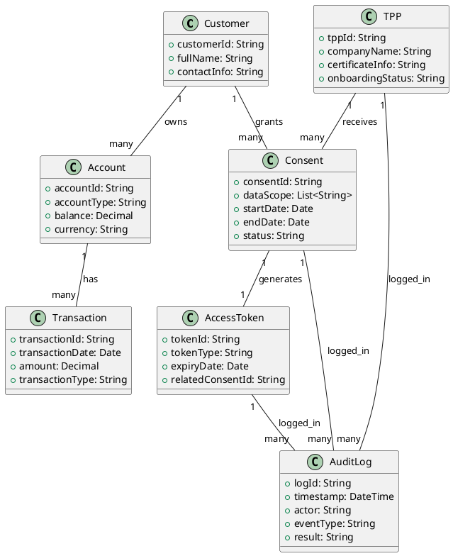

---

## 7. System Context Diagram

### Amaç
Platformun, dış aktörler ve mevcut bankacılık sistemleriyle olan sınırlarını ve ilişkilerini en üst seviyede göstermek (Solution Architecture Overview, Bölüm 1-2 ile uyumlu).

### Aktörler / Bileşenler
Customer, TPP, Düzenleyici Otorite, Open Banking Platform (sistem sınırı), Core Banking System (mevcut sistem), IAM Sistemi (mevcut sistem)

### Mermaid Formatı

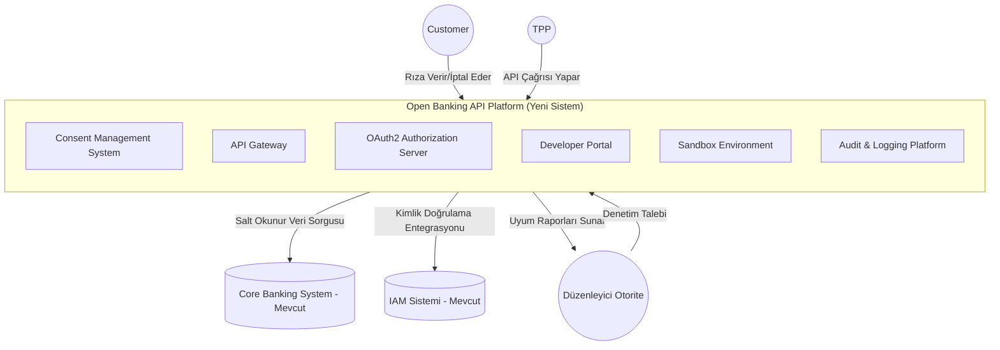

### Draw.io Uyumlu Açıklama
- **Şekil Önerisi:** C4 Model "System Context" notasyonu (veya basit UML Deployment/Component karışımı) — dış aktörler daire, sistem sınırı büyük dikdörtgen, mevcut sistemler silindir (veritabanı) şekliyle gösterilebilir
- **Sınır Vurgusu:** "Open Banking API Platform" kutusu kalın/kesikli çerçeve ile diğer mevcut sistemlerden (Core Banking, IAM) görsel olarak ayrılmalı — bu, Solution Architecture Overview'daki "mevcut sistemi değiştirmiyoruz, üzerine ekliyoruz" mesajını pekiştirir
- **Renk Kodlama:** Yeni geliştirilen bileşenler (Platform içi) mavi tonlarda, mevcut sistemler (Core Banking, IAM) gri tonlarda gösterilmeli

### PlantUML Formatı

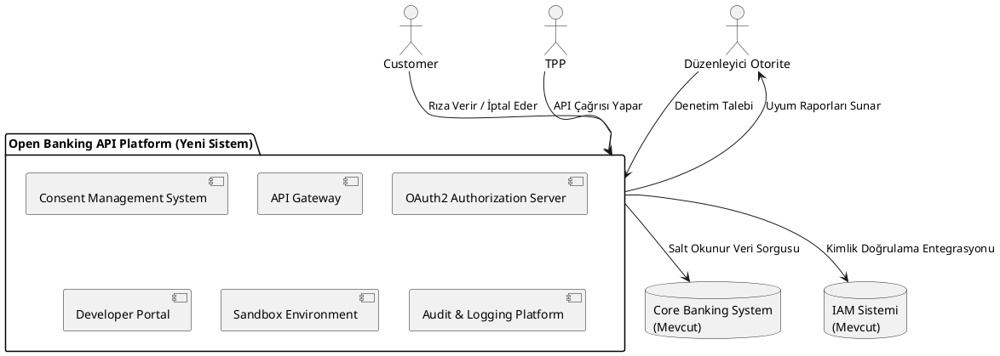

---

## Diyagram - Artefakt İzlenebilirlik Tablosu

| Diyagram | İlgili BRD/SRS/Architecture Referansı |
|---|---|
| Use Case Diagram | BRD Bölüm 9 (tüm BR'ler), Epic Model (Aşama 6) |
| Activity Diagram - Consent Management | FR-01, FR-04, FR-18, SEC-02 |
| Activity Diagram - TPP Onboarding | FR-07, FR-08, FR-09, FR-10, FR-11, FR-12 |
| Sequence Diagram - Account Information Request | FR-13, FR-14, FR-15, SEC-08 |
| Sequence Diagram - Consent Creation Flow | FR-01, FR-18, SEC-01, SEC-02 |
| Domain Model / Class Diagram | SRS Bölüm 7 (Data Requirements) |
| System Context Diagram | Solution Architecture Overview (Aşama 4.5, Bölüm 1-3) |

> **Modelleme Notu:** Tüm diyagramlar, gerçek bir bankacılık projesinde Solution Architect ve Geliştirme Ekibi'nin BA/PO dokümanlarından teknik tasarıma geçişte kullanacağı **köprü artefaktlardır**. Mermaid formatı GitHub'da doğrudan render edilebilir; PlantUML formatı kurumsal araçlarla (Confluence, IntelliJ plugin) entegrasyon için sunulmuştur; draw.io açıklamaları ise görsel/sunum amaçlı manuel diyagram oluşturma ihtiyacını karşılar.

---

Aşama 12 (UML ve Process Modeling Package) tamamlanmıştır. Yeni gereksinim veya test case eklenmemiştir.
